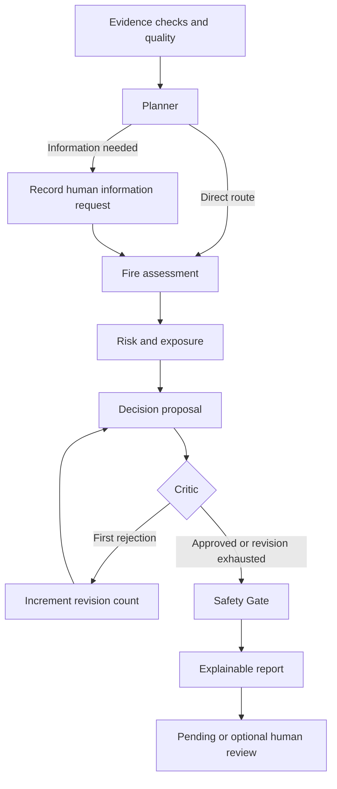

# FireWatch AI — V3 Architecture

## Dependent state and real branches

The `Pipeline` builds a LangGraph `StateGraph(WorkflowState)` for each run. The graph state is a TypedDict containing Pydantic-validated incident and specialist outputs. Every node returns updates consumed by later nodes. RunResult validates the finished output, including provenance, Safety Gate, revisions, trace and graph-step snapshots.

The Planner route selects whether the information-request node executes. It does not contact external sources or fill unknown fields. The Critic route executes Decision again only after the first rejection. A second rejection proceeds to Safety Gate with mandatory human review. Recursion limit 30 is an additional guard; the application enforces at most one revision independently.

`docs/workflow.mmd` is produced by the same compiled graph factory used for execution. The GUI renders its corresponding topology and highlights visited nodes. The route displayed below it comes from actual LangGraph stream updates, never a hard-coded list of claimed calls.

## Rule-based and LLM responsibilities

In deterministic mode, nodes use educational rules. In hybrid mode, Planner, Decision and Critic may call the Gemini adapter. Evidence, Fire Assessment, Risk/Exposure, Safety Gate and Reporter remain deterministic. LangGraph does not itself make these components LLM agents.

The deterministic Critic checks classification, contextual priority, citations and review requirements before the optional LLM Critic. Rejected proposals remain visibly unapproved after the limit. Reference assessment and contextual priority are retained; Safety Gate cannot be overridden by a proposal or later human-review record.

The gateway retains environment-only credentials, at most two attempts per call, timeout, structured validation and explicit fallback. The default mode does not call an external API. Live Gemini compatibility has not been verified; provider parsing and agent behavior are tested with offline doubles.

## Evidence quality

`EvidenceQuality` reports known/unknown smoke, flames and exposure fields, stale/future record IDs, manually flagged conflicts and counts of declared provenance types. COMPLETE means only that those three indicator fields are known. It does not mean evidence is correct, current, independent or sufficient for an operational decision. No confidence score or calibrated probability is computed.

The six-hour stale policy and five-minute future-time tolerance are demonstration choices. Weather and vegetation inputs are preserved context, not a fire-spread model. Source/provenance and conflict flags are declared metadata. Normalized fields drive rules; free text is not automatically extracted or reconciled.

## Streaming and persistence

LangGraph streams node updates. The coordinator creates detached `GraphStep` snapshots after each completed node, logs actual events and optionally calls an observer. GUI workers send updates through a queue; only the Tk thread updates widgets.

The live State view is provisional. Only a completed RunResult is saved in SQLite; intermediate snapshots are stored inside that completed result. There is no LangGraph checkpointer, pause/resume checkpoint or crash recovery for unfinished analyses. Human Gate records a pending requirement, while the user's later review is appended separately through SQLite. It is not a LangGraph interrupt.

SQLite's run snapshot remains authoritative. Incident/evidence tables provide convenient lookup; editing an observation does not rewrite older run snapshots. Human reviewer identity is self-reported. Database operations create, commit and close their own connections in the calling thread.

JSONL is an additional export after database commit. If file writing fails, the run may already exist in SQLite; check saved-run history first. V1 snapshots load with default empty graph steps and no quality summary. `reference_pipeline.py` preserves the V1 coordinator for regression comparison.

## Input/result separation

Editing the form invalidates current cards, report and review controls until another analysis or history load. If edits occur while a job is running, the completed earlier input is saved but not presented as a result for the edited form. Preset selection changes the input; reanalysis is always needed. Existing saved runs remain accessible through history.

## V3 supervised evaluation

`PilotEvaluation`, `EvaluationCase`, `EvaluationTrial` and `EvaluationMetrics` validate the comparison record. The evaluation function creates each synthetic input once and freezes its analysis time for two to five deterministic trials. It compares first-trial outputs with authored labels and a separate executable checklist, then compares repeated decision fields with each other. It does not invoke Gemini.

The protocol saves every trial RunResult and then its completed PilotEvaluation in SQLite. If evaluation is interrupted, completed trial runs may exist without a final pilot record. There is no evaluation resume/checkpointer. Later human reviews are separate records and do not retroactively modify the saved evaluation metrics. The new table is created alongside existing tables, without rewriting V1/V2 run snapshots.

The GUI uses the existing worker/queue pattern for evaluation. Summary cards and per-case rows are derived from stored typed data. CSV exports flattened comparisons and trial run IDs; JSON preserves the full evaluation structure. The Evidence inspector displays declarations and flags without changing the underlying reference rules.
