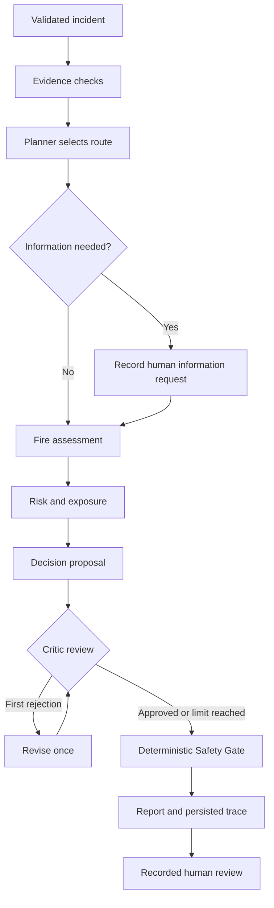

# Architecture

## Dependencies and state

`Incident` is validated before execution. `EvidenceResult`, `Assessment`, `Risk`, `Proposal`, `CriticReview` and `SafetyResult` are dependent typed outputs collected in `RunResult`. Each run has a UUID, schema/rule version, input snapshot, real events and duration.

The revision box represents another Decision invocation. After its review, the coordinator always proceeds to Safety Gate, even if the Critic still rejects. No unbounded agent loop exists.

## Honest component boundaries

In deterministic mode, all components are ordinary rule-based functions. In hybrid mode, only Planner, Decision and Critic call the configured Gemini adapter. A bounded coordinator executes the selected authorized route; the implementation does not use provider function-calling or LangGraph. This distinction matters when presenting the portfolio.

`assess_evidence` analyzes the existing record. `request_information_then_assess` first creates a pending-human-information trace event and then analyzes the existing record. Both retain mandatory evidence checks; the LLM cannot skip them.

The deterministic Critic checks classifications, priority, evidence IDs and required review before the optional LLM Critic. A rejected LLM proposal can remain visible as an unapproved proposal after the revision limit; the report and summary cards retain the reference assessment and risk, while Safety Gate requires human review.

## Provenance and persistence

Sources, methods and provenance are explicitly supplied metadata. They are not authenticated by this version. The GUI accepts one normalized manual record. The backend can receive multiple evidence records, but does not automatically reconcile their free text against normalized incident fields. `conflicts` is an explicit flag.

SQLite stores run snapshots as the authoritative record, plus incident/evidence tables for convenient lookup. Editing an incident does not rewrite older run snapshots. Human reviews are separate appended records linked to an existing run. Reviewer identity is self-reported; no login or authorization system is implemented.

JSONL is an additional trace export after database commit. If disk writing fails, the run may already exist in SQLite; recover it from saved-run history. Do not rerun an incident just to recreate its missing trace file without first checking history.

## Concurrency

Long analysis/evaluation jobs run in a worker thread. Workers never update Tk widgets; they put results on a queue polled by the UI thread. Analyze and Evaluate are disabled while a job is running. Database operations open, commit and close their own connection in the calling thread.

The LLM adapter has a fixed Google API host, configurable model name, environment-only credentials, two attempts maximum and safe error reporting. API output passes through Pydantic. Mocked tests do not establish live API compatibility, calibrated reliability or resistance to all prompt injection.

## V1 state presentation

`SharedState.from_run` validates detached copies of completed outputs and review records. This view is derived from the existing run snapshot; it does not replace the coordinator or represent a live message bus. Agents shows readable results and modes from actual events; Trace retains raw event detail. State includes later human-review records without rewriting the initial Safety Gate result.
